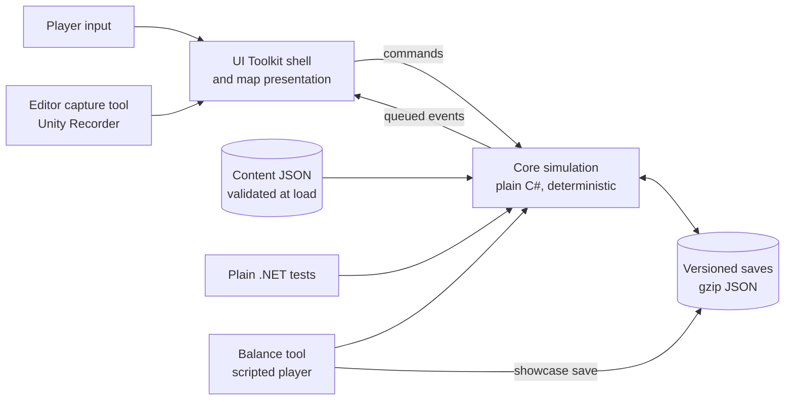

# Sekoya Transit

A transport and logistics tycoon game in Unity, built to show a deterministic simulation in plain C#, data-driven balance checked by a headless simulation, and a test suite that gates every change. Inspired by Transport Tycoon Deluxe and Rise of Industry.

**Play:** [sekoya-solutions.github.io/sekoya-transit](https://sekoya-solutions.github.io/sekoya-transit/), in a desktop browser (WebGL, about 29 MiB to download). You build roads, rails and stations, run trucks and trains between industries and towns, complete contracts and grow towns from 1900 on, on a map of 128, 256 or 512 tiles per side. The game is in English and French and saves in the browser.

Built by Fabrice Reynaud, tech lead, as a personal portfolio project.


| Network | Town |
| --- | --- |
|  |  |
|  |  |

The pictures show a game played by the balance tool's contract-only player from 1900 to the end of 1934 (Medium map, seed 1), made on 2026-11-18 by the [capture tool](docs/capture.md).

## What it demonstrates

- **A deterministic simulation.** The game rules are plain C# with no Unity types, driven only by player commands, so the same seed and the same commands always give the same world ([ADR 0003](docs/adr/0003-simulation-architecture.md)). A seeded PCG32 generator, fixed-point numbers and a hash of the full state make that testable ([ADR 0022](docs/adr/0022-pcg32-random-generator.md), [ADR 0023](docs/adr/0023-fixed-point-representation.md), [ADR 0025](docs/adr/0025-deterministic-state-hash-format.md)); the balance tool hashes the full state every game month, which is how a Core optimisation was proved to leave the played games unchanged ([Issue #308](https://github.com/sekoya-solutions/sekoya-transit/issues/308)).
- **Procedural maps up to 512 by 512 tiles.** Terrain, towns and industries come from deterministic noise and placement ([ADR 0014](docs/adr/0014-procedural-generation.md), [ADR 0027](docs/adr/0027-deterministic-gradient-noise.md) to [ADR 0029](docs/adr/0029-deterministic-industry-placement.md)). The map is drawn as custom 32 by 32 tile mesh chunks instead of Unity's Tilemap, chosen after a WebGL spike measured both ([ADR 0017](docs/adr/0017-map-rendering-approach-and-performance-budgets.md), [spike](docs/spikes/webgl-feasibility.md)).
- **Balance as data, checked by simulation.** Vehicles, industries, cargo, towns, contracts and achievements live in validated JSON ([ADR 0010](docs/adr/0010-data-driven-content-format.md), [content format](docs/specs/content-format.md)). A headless tool plays whole games on the real Core with a scripted player to check unlock timing and growth ([ADR 0033](docs/adr/0033-headless-balance-simulation.md), [economy and progression](docs/specs/economy-progression.md)); rules such as "a longer route always earns more per year" are guarded by tests.
- **Saves that keep working.** The save format is versioned (version 34) and saves from version 27 on are migrated on load, while older ones are refused with a clear message ([ADR 0009](docs/adr/0009-save-format-and-persistence.md)). In the demo, a Debug button downloads the running game as a file, and an Editor command opens such a file the way the game does and reports what it holds ([Issue #320](https://github.com/sekoya-solutions/sekoya-transit/issues/320)).
- **Every change gated.** Each pull request builds and tests the Core in plain .NET and checks formatting, Markdown and links; both checks are required on `main`. Unity tests run on `main`, and the WebGL demo is rebuilt and published after each merge that changes the game, only if its build succeeds ([ADR 0008](docs/adr/0008-continuous-integration.md), [ADR 0021](docs/adr/0021-unity-ci-minute-budget.md), [ADR 0034](docs/adr/0034-webgl-demo-on-github-pages.md)).
- **Two languages.** English and French, with a chooser on the start menu; the first launch follows the system or browser language ([ADR 0011](docs/adr/0011-localization.md), [Issue #338](https://github.com/sekoya-solutions/sekoya-transit/issues/338)).
- **Original art.** Towns, industries, vehicles, roads, rails and ground are original sprites generated with Grok Imagine ([ADR 0035](docs/adr/0035-original-map-sprites-from-grok-imagine.md)); interface icons are hand-written SVG ([ADR 0031](docs/adr/0031-ui-icons-as-hand-authored-svg.md)); sounds, music and a fallback industry sprite are CC0 ([credits](CREDITS.md)).
- **Promotional images made by a tool.** The pictures above come from committed shot files and a committed save, recorded in the Editor with Unity Recorder at a fixed frame rate; the save written by the balance tool is proved identical, byte for byte, to the file the game itself writes ([ADR 0036](docs/adr/0036-editor-capture-tool.md)).

## Key figures

| Figure | Value | Source |
| --- | --- | --- |
| Automated tests, 2026-11-18 | 944 plain .NET tests (Core, content, balance tool) and 1,688 Unity EditMode tests, all passing | Local runs for [pull request #353](https://github.com/sekoya-solutions/sekoya-transit/pull/353) |
| WebGL frame cost, Large map | Scripts take 0.08 to 0.10 ms per frame idle and 0.6 ms with 200 vehicles; 82.5 fps on a 165 Hz display, above the 60 fps budget (Chrome with hardware acceleration, RTX 5090) | [ADR 0017](docs/adr/0017-map-rendering-approach-and-performance-budgets.md) |
| WebGL download, 2026-11-18 | 29.3 MiB gzip-compressed (code 16.4 MB, data 14.2 MB) | Measured on the published demo |
| Game content | 15 industry types, 17 cargo types (passengers and mail included), 11 vehicle types (5 truck and 5 locomotive tiers, a wagon), 26 achievement tracks of bronze, silver and gold goals | [Content JSON](SekoyaTransit/Assets/_Project/Content/Data) |
| A 40-year simulated game | 59 s on a Small map, 76 s on a Large one, with the steady scripted player (32-thread machine) | [Balance tool](dotnet/SekoyaTransit.Balance/README.md) |
| Decisions on record | 36 Architecture Decision Records | [ADR index](docs/adr/README.md) |
| Delivered work, 2026-11-18 | V1 in 7 milestones, then 71 V2 issues; 195 merged pull requests | [Roadmap](docs/roadmap.md) |

## Architecture



The .NET tests and the balance tool compile the same Core source files as the game, without Unity, so they run in seconds and on any machine. The Unity side draws the world, plays sound, stores the saves and turns input into commands ([ADR 0004](docs/adr/0004-code-organization-and-ui.md)).

## How it is built

- **Decisions before code.** Each significant technical choice is an [Architecture Decision Record](docs/adr/README.md) (ADR) with the options considered and their trade-offs; nothing is implemented before Fabrice accepts it.
- **Measured, not assumed.** A WebGL spike measured map rendering before the choice was made, frame rates are measured in a hardware-accelerated browser, and economy claims are checked by the balance simulation rather than by formulas.
- **One path for every change:** an issue with acceptance criteria, a branch, a pull request, the required checks, then Fabrice's go and a squash merge. The [roadmap](docs/roadmap.md) sums up V1 and lists every V2 issue delivered.
- **AI agents, steered by a tech lead.** Fabrice Reynaud, a tech lead with over 15 years of experience, decides every technical choice and reviews the code; AI coding agents write the code and the documentation under the standing rules in [AGENTS.md](AGENTS.md). The [case study](docs/portfolio.md) tells more.

## Stack

Unity 6.3 LTS with the 2D Universal Render Pipeline, UI Toolkit, the Input System, Localization and the Unity Test Framework; C# 9 shared with .NET 10 for the plain tests and the balance tool; Unity Recorder for the capture tool; GitHub Actions with GameCI, GitHub Pages for the demo, Git LFS for binary assets, markdownlint and lychee for the documentation. The [ADR index](docs/adr/README.md) gives the reason for each.

## Run it locally

The Core tests need only the .NET 10 SDK:

```bash
dotnet test dotnet/SekoyaTransit.Core.Tests
```

Open the `SekoyaTransit/` folder in Unity Hub with Unity 6.3 LTS ([ADR 0015](docs/adr/0015-unity-editor-version-policy.md)) to play in the Editor or run the EditMode tests. The [balance tool README](dotnet/SekoyaTransit.Balance/README.md) and the [capture tool guide](docs/capture.md) explain the two developer tools.

## License

Source visible for review; all rights reserved. See [LICENSE](LICENSE). Third-party assets keep their own licenses (CC0 1.0), listed in [CREDITS.md](CREDITS.md).
