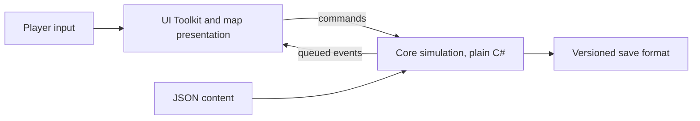

# Portfolio write-up: Sekoya Transit

Sekoya Transit is a transport and logistics tycoon game, inspired by Transport Tycoon Deluxe (TTD) and Rise of Industry. It is a personal project built to show how I design, build and verify a non-trivial piece of software. The [live demo](https://sekoya-solutions.github.io/sekoya-transit/) runs in the browser; the [README](../README.md) gives the short version and the key figures.

## Goals

- Ship a playable game, not a tech demo: roads, rails, production chains, towns, money, goals.
- Keep the architecture ready for later versions (AI opponents and multiplayer are in the long-term scope), so the simulation had to be deterministic and driven by commands from day one ([product vision](specs/product-vision.md)).
- Prove quality with automation: regression tests, continuous integration (CI), and a documented trail of decisions.

## Architecture

- **Simulation separated from presentation.** `Core` is plain C# with no Unity types. Unity only observes it and sends commands ([ADR 0003](adr/0003-simulation-architecture.md), [ADR 0004](adr/0004-code-organization-and-ui.md)). This keeps tests fast (plain .NET) and makes the game replayable.
- **Determinism as a tested property.** A seeded PCG32 generator ([ADR 0022](adr/0022-pcg32-random-generator.md)), fixed-point arithmetic ([ADR 0023](adr/0023-fixed-point-representation.md)) and a state hash ([ADR 0025](adr/0025-deterministic-state-hash-format.md)) let tests assert that the same seed and commands give the same world, and that a save and load round trip changes nothing.
- **Procedural worlds.** Terrain, towns and industries come from deterministic noise and placement algorithms ([ADR 0014](adr/0014-procedural-generation.md), [ADR 0027](adr/0027-deterministic-gradient-noise.md), [ADR 0028](adr/0028-deterministic-town-placement.md), [ADR 0029](adr/0029-deterministic-industry-placement.md)), on maps up to 512x512 tiles.
- **Data-driven balance.** Vehicles, industries, cargo, towns, economy, contracts and achievements are JSON validated at load ([ADR 0010](adr/0010-data-driven-content-format.md), [content format](specs/content-format.md)). Prices, costs, unlocks and growth rules are identical on every map size; only the layout, goals, town need difficulty and contract settings may differ ([gameplay systems](specs/gameplay-systems.md)).
- **Rendering for scale.** The map is drawn as custom 32x32-tile mesh chunks rather than Unity Tilemap, with pooled vehicle sprites and allocation-free idle frames ([ADR 0017](adr/0017-map-rendering-approach-and-performance-budgets.md)).
- **Versioned saves.** The save format is at version 34; saves from version 27 on are migrated on load ([ADR 0009](adr/0009-save-format-and-persistence.md)).

## Testing and CI

- 944 plain .NET tests (Core, content and the balance tool) and 1,688 Unity EditMode tests on 2026-11-18 ([ADR 0007](adr/0007-testing-strategy.md)).
- Every pull request runs the plain .NET build, tests and format check plus a Markdown lint and link check; both are required by branch protection on `main` ([ADR 0008](adr/0008-continuous-integration.md)).
- Unity EditMode runs on `main` pushes that change the game, and the WebGL demo is rebuilt and published automatically after such a push, only if its build succeeds; pull requests run EditMode locally, to respect the Actions minute budget ([ADR 0021](adr/0021-unity-ci-minute-budget.md), [ADR 0030](adr/0030-selective-local-unity-platform-builds.md), [ADR 0034](adr/0034-webgl-demo-on-github-pages.md)).
- A headless balance simulation plays a scripted player on the real Core to check that the economy and unlock timing hit their targets ([ADR 0033](adr/0033-headless-balance-simulation.md), [economy and progression](specs/economy-progression.md)). Its state hash proved that a Core optimisation left the played games unchanged.
- A player's save file can be downloaded from the demo and opened by an Editor command that reports its state, so a bug report comes with the exact game ([Issue #320](https://github.com/sekoya-solutions/sekoya-transit/issues/320)).

## V2 so far

V1 was done on 2026-10-29. V2 is a stream of single issues, 71 delivered by 2026-11-18 ([roadmap](roadmap.md)). The main ones:

- **Original art:** towns, industries, vehicles of five tiers, stations, roads, rails and ground as original Grok Imagine sprites ([ADR 0035](adr/0035-original-map-sprites-from-grok-imagine.md)).
- **French:** a full translation and a language chooser; the first launch follows the system or browser language ([Issue #338](https://github.com/sekoya-solutions/sekoya-transit/issues/338)).
- **Deeper play:** named routes in a Routes window, a contracts cycle (proposal, accepted, completed, failed), achievements as bronze, silver and gold tracks, a finances table, town and industry growth levels, and trains bought with a chosen number of wagons.
- **Rebalancing with evidence:** prices, upkeep, unlock costs and distance pay were tuned with the balance simulation, including a contract-only player and a one-vehicle income test ([Issue #347](https://github.com/sekoya-solutions/sekoya-transit/issues/347)).
- **Promotional capture:** an Editor tool records the README's screenshots and animation from shot files and a save written by the balance tool ([ADR 0036](adr/0036-editor-capture-tool.md)).

## AI-assisted workflow

The code is written by AI coding assistants under my direction; I review every technical choice and most of the code.

- Standing rules for every agent live in [AGENTS.md](../AGENTS.md): small reviewable pull requests, Conventional Commits, no merge without my approval, no software installs without approval, root causes before fixes, and regression tests that fail without the change.
- Decisions are proposed as ADRs with options and trade-offs, and only I mark them Accepted.
- Work is tracked as GitHub issues with acceptance criteria, ticked when verified against the merged result.

## Key decisions

| Decision | Why |
| --- | --- |
| Unity 6.3 LTS and 2D Universal Render Pipeline (URP) ([ADR 0001](adr/0001-unity-version.md), [ADR 0002](adr/0002-render-pipeline.md)) | Long-term support, WebGL target, 2D sprite pipeline. |
| Pure C# Core with commands ([ADR 0003](adr/0003-simulation-architecture.md)) | Determinism, fast tests, future AI and multiplayer. |
| Original Grok Imagine sprites, after Kenney CC0 art in V1 ([ADR 0035](adr/0035-original-map-sprites-from-grok-imagine.md), [ADR 0032](adr/0032-map-art-from-kenney-cc0-packs.md)) | An original look for a portfolio piece; the sprites are used as generated, and a Kenney model stays as the generic industry fallback. |
| Hand-authored SVG icons ([ADR 0031](adr/0031-ui-icons-as-hand-authored-svg.md)) | Crisp at any size, tiny download, reviewable in diffs. |
| WebGL demo on GitHub Pages, gzip with a decompression fallback ([ADR 0034](adr/0034-webgl-demo-on-github-pages.md)) | Free hosting and a fresh build after every game change; the first release build was 24.4 MiB, within the 25 MB V1 budget. |

The full list is in the [ADR index](adr/README.md).

## Limits and lessons

- The game has flat terrain, road and rail only, and a single player. Slopes, water, air, AI opponents and a minimap are later scope ([scope](specs/product-vision.md)).
- The WebGL player is large for a browser game: 29.3 MiB to download on 2026-11-18, above the 25 MB budget set for V1. It loads slowly on weak connections.
- A long-lived AI-assisted project needs process more than prompts: written rules, decisions on record, and tests that fail loudly were what kept sessions consistent.
- Performance must be measured on real hardware. Software-rendered browsers hid the game's own cost, so frame-rate numbers in the ADRs come from hardware-accelerated Chrome.
- Claims about the economy need measuring: a formula model misses what whole games show, such as finished goods with no buyer ([ADR 0033](adr/0033-headless-balance-simulation.md)), so economy figures come from simulation runs.

## Next

V2 continues as single issues from the owner's prompts, with no fixed plan; the [roadmap](roadmap.md) lists what has been delivered and the [product vision](specs/product-vision.md) what is in scope.
