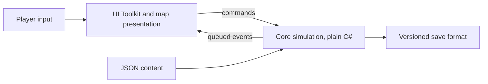

# Portfolio write-up: Sekoya Transit

Sekoya Transit is a transport and logistics tycoon game, inspired by Transport Tycoon Deluxe (TTD) and Rise of Industry. It is a personal project built to show how I design, build and verify a non-trivial piece of software. The [live demo](https://sekoya-solutions.github.io/sekoya-transit/) runs in the browser.

## Goals

- Ship a playable vertical slice, not a tech demo: roads, rails, production chains, towns, money, goals.
- Keep the architecture ready for later versions (AI opponents in V2, multiplayer in V3+), so the simulation had to be deterministic and driven by commands from day one ([product vision](specs/product-vision.md)).
- Prove quality with automation: regression tests, continuous integration (CI), and a documented trail of decisions.

## Architecture

- **Simulation separated from presentation.** `Core` is plain C# with no Unity types. Unity only observes it and sends commands ([ADR 0003](adr/0003-simulation-architecture.md), [ADR 0004](adr/0004-code-organization-and-ui.md)). This keeps tests fast (plain .NET) and makes the game replayable.
- **Determinism as a tested property.** A seeded PCG32 generator ([ADR 0022](adr/0022-pcg32-random-generator.md)), fixed-point arithmetic ([ADR 0023](adr/0023-fixed-point-representation.md)) and a state hash ([ADR 0025](adr/0025-deterministic-state-hash-format.md)) let tests assert that the same seed and commands give the same world, and that a save and load round trip changes nothing.
- **Procedural worlds.** Terrain, towns and industries come from deterministic noise and placement algorithms ([ADR 0014](adr/0014-procedural-generation.md), [ADR 0027](adr/0027-deterministic-gradient-noise.md), [ADR 0028](adr/0028-deterministic-town-placement.md), [ADR 0029](adr/0029-deterministic-industry-placement.md)), on maps up to 512x512 tiles.
- **Data-driven balance.** Vehicles, industries, economy, contracts and achievements are JSON validated at load ([ADR 0010](adr/0010-data-driven-content-format.md), [content format](specs/content-format.md)).
- **Rendering for scale.** The map is drawn as custom 32x32-tile mesh chunks rather than Unity Tilemap, with pooled vehicle sprites and allocation-free idle frames ([ADR 0017](adr/0017-map-rendering-approach-and-performance-budgets.md)).
- **Versioned saves.** The save format is versioned (currently v25; [ADR 0009](adr/0009-save-format-and-persistence.md)).

## Testing and CI

- More than 1,000 automated tests: plain .NET tests for Core and Unity EditMode tests ([ADR 0007](adr/0007-testing-strategy.md)).
- Every pull request runs the plain .NET build, tests and format check plus a Markdown lint and link check; both are required by branch protection on `main` ([ADR 0008](adr/0008-continuous-integration.md)).
- Unity EditMode runs on `main` pushes, and the WebGL demo is built and deployed by a manual workflow, to respect the Actions minute budget ([ADR 0021](adr/0021-unity-ci-minute-budget.md), [ADR 0034](adr/0034-webgl-demo-on-github-pages.md)).
- A headless balance simulation plays a scripted player on the real Core to check that the economy and unlock timing hit their targets ([ADR 0033](adr/0033-headless-balance-simulation.md), [economy and progression](specs/economy-progression.md)).

## AI-assisted workflow

The code is written by AI coding assistants under my direction; I review every technical choice and most of the code.

- Standing rules for every agent live in [AGENTS.md](../AGENTS.md): small reviewable pull requests, Conventional Commits, no merge without my approval, no software installs without approval.
- Decisions are proposed as ADRs with options and trade-offs, and only I mark them Accepted.
- Work is tracked as GitHub issues with acceptance criteria, ticked when verified against the merged result.
- Agents keep a local chat history so a new session can pick up context; those logs are not published.

## Key decisions

| Decision | Why |
| --- | --- |
| Unity 6.3 LTS and 2D Universal Render Pipeline (URP) ([ADR 0001](adr/0001-unity-version.md), [ADR 0002](adr/0002-render-pipeline.md)) | Long-term support, WebGL target, 2D sprite pipeline. |
| Pure C# Core with commands ([ADR 0003](adr/0003-simulation-architecture.md)) | Determinism, fast tests, future AI and multiplayer. |
| Kenney CC0 art, baked to sprites ([ADR 0032](adr/0032-map-art-from-kenney-cc0-packs.md)) | Clear licensing and a consistent look; AI art generation was evaluated ([art pipeline](specs/art-pipeline.md)) but not production-ready. |
| Hand-authored SVG icons ([ADR 0031](adr/0031-ui-icons-as-hand-authored-svg.md)) | Crisp at any size, tiny download, reviewable in diffs. |
| Release WebGL build under 25 MB ([ADR 0034](adr/0034-webgl-demo-on-github-pages.md)) | Fast first load for visitors; the first release build is 24.4 MiB, at the budget. |

The full list is in the [ADR index](adr/README.md).

## Limits and lessons

- V1 is flat terrain, road and rail only, single player, English only. Slopes, water, air, AI opponents and a minimap are V2 or later ([scope](specs/product-vision.md)).
- The WebGL player is large for a browser game and loads slowly on weak connections; the size budget was a deliberate trade-off against features.
- A long-lived AI-assisted project needs process more than prompts: written rules, decisions on record, and tests that fail loudly were what kept sessions consistent.
- Performance must be measured on real hardware. Software-rendered browsers hid the game's own cost, so frame-rate numbers in the ADRs come from hardware-accelerated Chrome.

## Next

Further balance tuning per map size is planned. See the [roadmap](roadmap.md).
